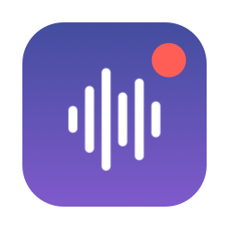
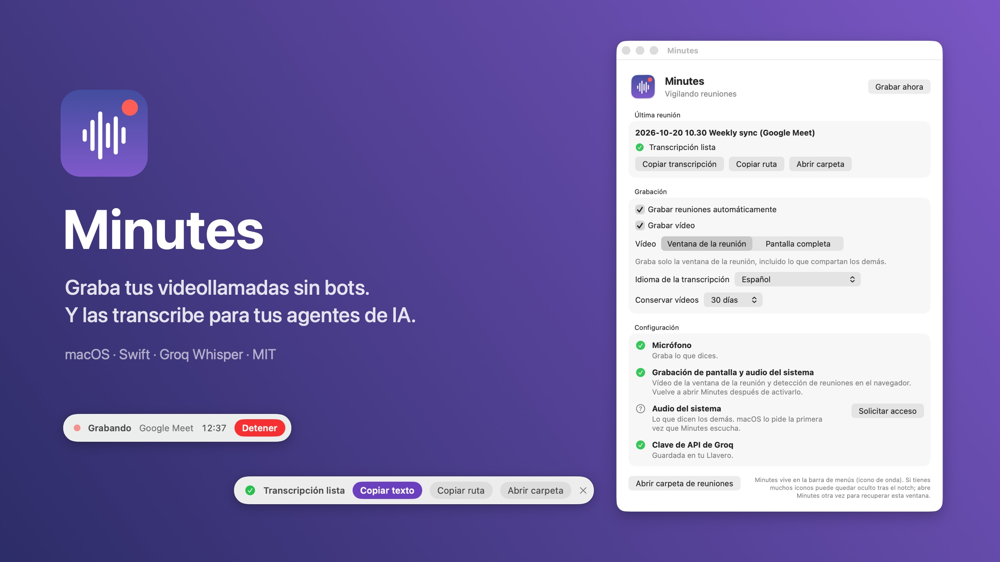
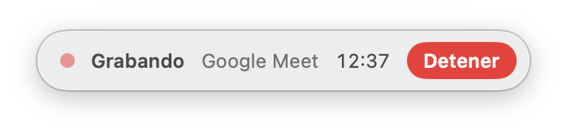
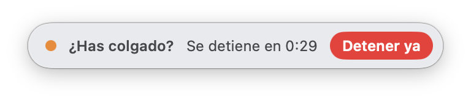
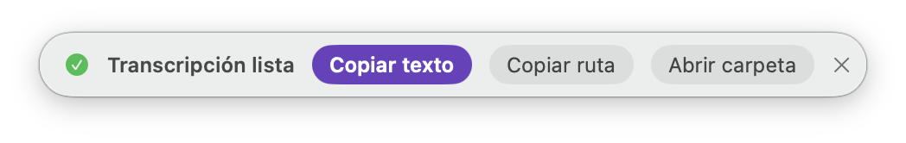
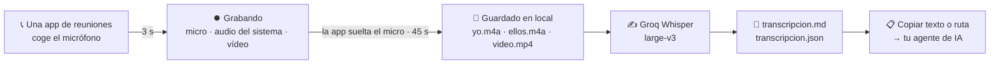

<div align="center">



# Minutes

**Graba tus videollamadas sin bots. Y obtén transcripciones que tus agentes de IA pueden leer.**

[](README.md)
[](README.es.md)

[](#-requisitos)
[](Package.swift)
[](LICENSE)



</div>

Minutes es una app nativa y diminuta para la barra de menús de macOS. Detecta cuándo empieza una llamada, la graba **sin entrar en la reunión**, la transcribe con Groq al colgar y te lo deja todo en tu Mac como archivos normales: vídeo, dos pistas de audio y una transcripción en Markdown lista para pegar en tu agente de IA.

## ⚡ Empieza en un minuto

```bash
git clone https://github.com/xabilarra/minutes.git
cd minutes
scripts/build-app.sh --install
open /Applications/Minutes.app
```

1. Concede **Micrófono**, **Grabación de pantalla y audio del sistema** y **Audio del sistema** desde la ventana de Minutes.
2. Pega tu [clave de API de Groq](https://console.groq.com/keys). Se queda en el Llavero de macOS.
3. Entra en una llamada. Minutes empieza a grabar solo.

## ✨ Qué hace

| | |
|---|---|
| 🎙️ **Arranca solo** | Detecta Zoom, Teams, Slack, Webex, FaceTime, WhatsApp, Discord, y Google Meet / Teams / Zoom / Whereby / Jitsi en el navegador. Sin bots ni invitaciones: nadie entra en la llamada. |
| 🎧 **Dos pistas limpias** | Tu micrófono (**Yo**) y los demás participantes (**Ellos**) se graban por separado con un *process tap* de Core Audio, así la transcripción sabe quién dijo qué. |
| 🖥️ **Vídeo nítido** | La ventana de la reunión (con lo que compartan los demás) o la pantalla completa (con lo que presentes tú), a resolución nativa hasta 2560 px, HEVC por hardware, unos 0,5 GB por hora. |
| 📋 **Listo para tu agente** | Transcripciones en Markdown y JSON con marcas de tiempo alineadas con el vídeo. Al colgar, un clic para copiar el texto o la ruta del archivo. |
| 🧹 **Transcripciones limpias** | Se saltan los silencios, se filtran las frases que Whisper se inventa y se quita de tus líneas el eco de tus altavoces. |
| 🔒 **Local y privado** | Las grabaciones y transcripciones nunca salen de tu Mac; solo los trozos de audio van a Groq para transcribirse. Sin cuenta ni telemetría. |
| 🪶 **Ligerísimo** | Una app SwiftUI de 2 MB. La captura y la compresión usan los frameworks de macOS y el chip multimedia. |
| 🌍 **Bilingüe** | Interfaz en español e inglés. Transcribe en tu idioma o deja que Whisper lo detecte. |

## 🟣 La pastilla flotante

Minutes muestra una pequeña pastilla bajo la barra de menús. Se ve encima de las reuniones a pantalla completa y nunca le quita el foco a la llamada.

<table>
  <tr>
    <td align="center"><br><sub><b>Durante la llamada</b>: tiempo y botón Detener</sub></td>
    <td align="center"><br><sub><b>Al colgar</b>: se detiene en 45 s, o ya</sub></td>
  </tr>
  <tr>
    <td align="center" colspan="2"><br><sub><b>Transcripción lista</b>: cópiala directa a tu agente</sub></td>
  </tr>
</table>

## 🧠 Cómo funciona



- **Detección**: cada segundo consulta a Core Audio qué procesos usan la entrada de audio y los compara con las apps de reuniones conocidas. Las pestañas del navegador solo cuentan si el título de la ventana parece una reunión.
- **Audio**: un *process tap* global y privado graba el audio del sistema, y `AVAudioEngine` graba el micrófono; ambos en mono a 16 kHz, alineados con el reloj del sistema.
- **Vídeo**: ScreenCaptureKit y `AVAssetWriter` (HEVC), escrito como película fragmentada que sobrevive a un cierre inesperado y convertida a MP4 al final. Las ventanas de Minutes nunca salen en el vídeo.
- **Transcripción** al terminar la llamada: trozos de hasta 10 minutos, se saltan los silenciosos, se descartan los segmentos sobre silencio y las alucinaciones típicas de Whisper, y se quita el eco de los demás de tu micrófono.

## 📁 Qué obtienes

```text
~/Reuniones/2026-10-20 10.30 Weekly sync (Google Meet)/
├── video.mp4            ventana de la reunión o pantalla
├── yo.m4a               tu micrófono
├── ellos.m4a            los demás participantes
├── transcripcion.md     lista para pegar en un agente
├── transcripcion.json   segmentos con inicio y fin exactos y quién habla
└── meta.json            app, título, inicio y fin, duración, desfase del vídeo, estado
```

```markdown
# Weekly sync — 2026-10-20 10:30

- App: Google Meet
- Duración: 00:42:13
- Vídeo: video.mp4 (desfase +0.4 s)
- Audio: yo.m4a (Yo), ellos.m4a (Ellos)

## Transcripción

[00:00:03] Ellos: ¡Buenos días! ¿Empezamos con el presupuesto?
[00:00:07] Yo: Sí, te comparto la hoja ahora.
```

Los vídeos van a la Papelera pasado el tiempo que elijas (7, 30, 90 días o nunca); el audio y las transcripciones se conservan.

## 📋 Requisitos

- macOS 15 o posterior
- Xcode 16 o posterior (Swift 6) para compilar
- Una [clave de API de Groq](https://console.groq.com/keys): `whisper-large-v3` cuesta unos 0,11 $ por hora de audio en el momento de escribir esto, y cada reunión tiene dos pistas

## 🛠️ Instalación

`scripts/build-app.sh --install` compila una versión release, la firma y copia `Minutes.app` a `/Applications`.

Firma con tu certificado **Apple Development** si lo tienes (es gratis: Xcode → Ajustes → Cuentas → Gestionar certificados). macOS asocia los permisos de privacidad a la firma, así que con certificado los recuerda entre compilaciones. Sin él, la app se firma *ad hoc* y macOS vuelve a pedir los permisos tras cada compilación.

Minutes vive en la barra de menús (icono de onda). En Macs con muchos iconos puede quedar oculto tras el notch; al abrir Minutes otra vez siempre vuelve su ventana. Usa cascos cuando puedas para que la pista "Yo" salga más limpia.

## 🔒 Privacidad y uso responsable

- Las grabaciones y transcripciones se quedan en tu Mac. Solo los trozos de audio se envían a Groq para transcribirlos.
- Las leyes sobre grabaciones cambian de un país a otro: en algunos sitios **todos los participantes deben dar su consentimiento**. Minutes no se anuncia en la llamada, así que avisa de que estás grabando.

## 🚧 Limitaciones

- Solo macOS. La transcripción necesita Groq; todavía no hay modelo local.
- Distingue entre "tú" y "los demás"; no identifica nombres concretos.
- Los nombres de carpetas y archivos están en español.

## 👩‍💻 Desarrollo

```bash
swift test                               # tests: lógica del núcleo y cola de transcripción
scripts/build-app.sh                     # compila y firma en build/Minutes.app
scripts/check-localizations.sh           # cada texto en español tiene traducción al inglés
scripts/capture-screenshots.sh           # capturas del README con el modo demostración
swift scripts/make-readme-images.swift   # imágenes de cabecera del README
swift scripts/make-icon.swift            # Resources/AppIcon.icns
```

Módulos: `MinutesCore` (lógica pura), `MinutesCapture` (Core Audio, AVFoundation, ScreenCaptureKit) y `Minutes` (la app). Los textos de la interfaz están en español en el código; `Resources/en.lproj` tiene las traducciones al inglés.

Para una prueba de principio a fin, cierra Minutes y ejecuta `open build/Minutes.app --args --smoke-test 20`: graba la app que tengas delante durante 20 segundos, la transcribe y se cierra. Registros: `log show --last 10m --predicate 'subsystem == "io.github.xabilarra.Minutes"'`.

## 💜 Hecho con Gentle AI

Minutes se ha diseñado, construido, revisado y probado con [Gentle AI](https://github.com/Gentleman-Programming/gentle-ai), que configura los agentes de programación con IA con memoria persistente, Organic-Driven Development y revisión de código acotada.

<a href="https://github.com/Gentleman-Programming/gentle-ai">
  
</a>

## 📄 Licencia

[MIT](LICENSE) © Xabi Larrañaga. Si Minutes te quita un bot de tus llamadas, una ⭐ ayuda.
