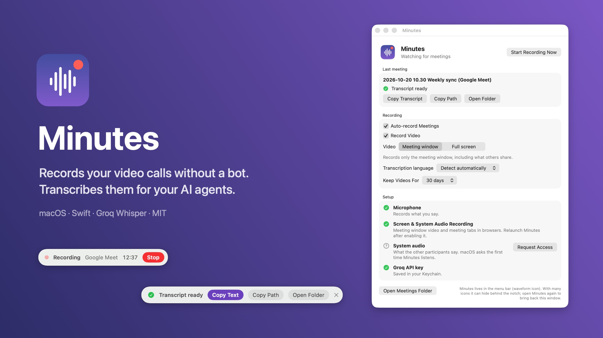
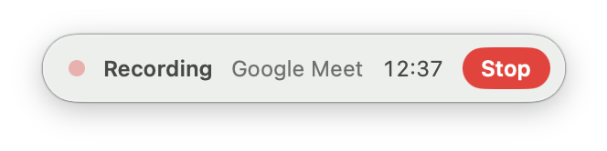
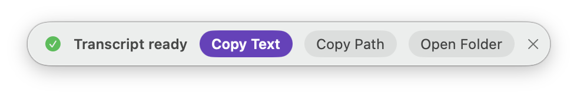
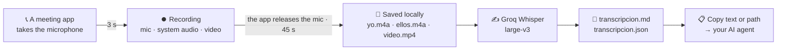

<div align="center">


# Minutes

**Record your video calls without a bot. Get transcripts your AI agents can read.**

[](README.md)
[](README.es.md)

[](#-requirements)
[](Package.swift)
[](LICENSE)
[](https://github.com/Gentleman-Programming/gentle-ai)



</div>

Minutes is a tiny native menu-bar app for macOS. It notices when a call starts, records it **without joining the meeting**, transcribes it with Groq when you hang up, and leaves everything on your Mac as plain files: video, two audio tracks, and a Markdown transcript ready to paste into your AI agent.

## ⚡ Quickstart

```bash
git clone https://github.com/xabilarra/minutes.git
cd minutes
scripts/build-app.sh --install
open ~/Applications/Minutes.app
```

1. Grant **Microphone**, **Screen & System Audio Recording** and **System audio** from the Minutes window.
2. Paste your [Groq API key](https://console.groq.com/keys). It stays in your macOS Keychain.
3. Join a call. Minutes starts recording by itself.

## ✨ Features

| | |
|---|---|
| 🎙️ **Starts by itself** | Detects Zoom, Teams, Slack, Webex, FaceTime, WhatsApp, Discord, and Google Meet / Teams / Zoom / Whereby / Jitsi in the browser. No bot, no invite, nothing joins the call. |
| 🎧 **Two clean tracks** | Your microphone (**Yo**) and the other participants (**Ellos**) are recorded separately with a Core Audio process tap, so the transcript knows who said what. |
| 🖥️ **Sharp video** | The meeting window (including what others share) or the whole screen (including what you present), native resolution up to 2560 px, hardware HEVC, about 0.5 GB per hour. |
| 📋 **Agent-ready** | Markdown and JSON transcripts with timestamps that line up with the video. One click to copy the text or the file path when the call ends. |
| 🧹 **Clean transcripts** | Silence is skipped, Whisper's invented phrases are filtered out, and your speakers' echo is removed from your lines. |
| 🔒 **Local and private** | Recordings and transcripts never leave your Mac; only audio chunks go to Groq to be transcribed. No account, no telemetry. |
| 🪶 **Featherweight** | A 2 MB SwiftUI app. Capture and encoding run on macOS' own frameworks and media engine. |
| 🌍 **Bilingual** | Spanish and English UI. Transcribe in your language or let Whisper detect it. |

## 🟣 The floating pill

Minutes shows a small pill under the menu bar. It sits above full-screen meetings and never steals focus from the call.

<table>
  <tr>
    <td align="center"><br><sub><b>During the call</b>: elapsed time and Stop</sub></td>
    <td align="center"><br><sub><b>After hanging up</b>: stops in 45 s, or now</sub></td>
  </tr>
  <tr>
    <td align="center" colspan="2"><br><sub><b>Transcript ready</b>: copy it straight into your agent</sub></td>
  </tr>
</table>

## 🧠 How it works



- **Detection** polls Core Audio's process list every second for apps whose audio input is running and matches them against known meeting apps. Browser tabs count only when the window title looks like a meeting.
- **Audio**: a private global process tap records system audio and `AVAudioEngine` records the microphone, both as 16 kHz mono tracks aligned on the host clock.
- **Video**: ScreenCaptureKit and `AVAssetWriter` (HEVC), written as a crash-tolerant fragmented movie and remuxed to MP4 at the end. Minutes' own windows are never recorded.
- **Transcription** runs after the call: chunks of up to 10 minutes, silent chunks skipped, segments over silence and known Whisper hallucinations dropped, microphone echo of the other side removed.

## 📁 What you get

```text
~/Reuniones/2026-10-20 10.30 Weekly sync (Google Meet)/
├── video.mp4            meeting window or screen
├── yo.m4a               your microphone
├── ellos.m4a            the other participants
├── transcripcion.md     ready to paste into an agent
├── transcripcion.json   segments with exact start/end seconds and speaker
└── meta.json            app, title, start/end, duration, video offset, status
```

```markdown
# Weekly sync — 2026-10-20 10:30

- App: Google Meet
- Duración: 00:42:13
- Vídeo: video.mp4 (desfase +0.4 s)
- Audio: yo.m4a (Yo), ellos.m4a (Ellos)

## Transcripción

[00:00:03] Ellos: Morning! Shall we start with the budget?
[00:00:07] Yo: Sure, I'm sharing the sheet now.
```

Folder, file and speaker names are Spanish: *Reuniones* = meetings, *transcripción* = transcript, **Yo** = me, **Ellos** = them. Videos move to the Trash after the retention you choose (7, 30, 90 days or never); audio and transcripts are kept.

## 📋 Requirements

- macOS 15 or later
- Xcode 16 or later (Swift 6) to build
- A [Groq API key](https://console.groq.com/keys): `whisper-large-v3` costs around $0.11 per audio hour at the time of writing, and a meeting has two tracks

## 🛠️ Install

`scripts/build-app.sh --install` builds a release, signs it and copies `Minutes.app` to `~/Applications`.

It signs with your **Apple Development** certificate when you have one (free: Xcode → Settings → Accounts → Manage Certificates). macOS ties privacy permissions to the signature, so with a certificate it remembers them across rebuilds. Without one, the app is signed ad hoc and macOS asks again after every rebuild.

Minutes lives in the menu bar (waveform icon). On Macs with many menu bar icons it can hide behind the notch; opening Minutes again always brings its window back. Use headphones when you can for the cleanest "Yo" track.

## 🔒 Privacy and responsible use

- Recordings and transcripts stay on your Mac. Only the audio chunks are sent to Groq to be transcribed.
- Recording laws differ: in some places **every participant must consent**. Minutes does not announce itself in the call, so tell people you are recording.

## 🚧 Limitations

- macOS only. Transcription needs Groq; there is no on-device model yet.
- Speakers are "you" and "the others"; individual names are not identified.
- Output names are Spanish.

## 👩‍💻 Development

```bash
swift test                               # unit tests: core logic and the transcription pipeline
scripts/build-app.sh                     # build and sign into build/Minutes.app
scripts/check-localizations.sh           # every Spanish UI string has an English translation
scripts/capture-screenshots.sh           # README screenshots from the app's showcase mode
swift scripts/make-readme-images.swift   # README hero images
swift scripts/make-icon.swift            # Resources/AppIcon.icns
```

Targets: `MinutesCore` (pure logic), `MinutesCapture` (Core Audio, AVFoundation, ScreenCaptureKit) and `Minutes` (the menu-bar app). UI strings are written in Spanish in the code; `Resources/en.lproj` holds the English translations.

For an end-to-end check, quit Minutes and run `open build/Minutes.app --args --smoke-test 20`: it records the frontmost app for 20 seconds, transcribes it and quits. Logs: `log show --last 10m --predicate 'subsystem == "io.github.xabilarra.Minutes"'`.

## 💜 Made with Gentle AI

Minutes was designed, built, reviewed and tested with [Gentle AI](https://github.com/Gentleman-Programming/gentle-ai), which sets up AI coding agents with persistent memory, Organic-Driven Development and bounded code review.

## 📄 License

[MIT](LICENSE) © Xabi Larrañaga. If Minutes keeps a bot out of your calls, a ⭐ helps.
